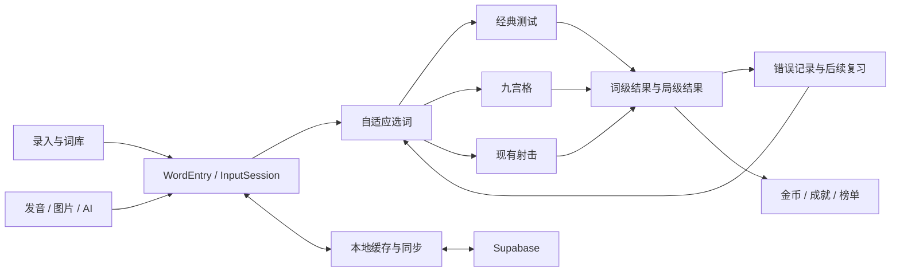

# 项目架构与游戏体验改进方案

日期：2026-10-22；桌面产品范围与验收标准更新：2026-10-23

实施状态与后续阶段以 [V2 阶段重构计划](./phased-refactor-v2.md) 为准；该计划已加入逐词复习日程和多 Agent 分工，跑酷与九格连线已进入正式代码实现。

## 当前产品范围与视觉验收

本应用面向电脑横屏，主要操作方式是键盘与鼠标。所有当前及后续视觉测试采用 **1366×768、1440×900、1920×1080** 三档视口；验证键盘连续输入和 Enter 提交、鼠标点击、焦点保持与恢复，以及游戏场景、题目和输入区在同一视口中同时可见。

截图必须使用视口截图，不使用整页长截图掩盖首屏布局问题。手机竖屏、软键盘及移动适配不列为当前待办或上线门槛。本文末尾的 320px/375px 结果保留为历史附加检查，已撤出当前验收口径，不能替代或改称桌面验收。

最新方向：根据试玩反馈，射击替代方案改为第三人称小星球跑酷“Word Orbit 星词漫游”。此前 Word Pulse 的视觉和动作变化不足，保留其稳定输入、即时判题与就地纠错的原则；表现形式改为答对越障、答错跌倒恢复。下面的 Word Pulse 章节保留为早期设计记录，后续实现以“星球跑酷修订”章节为准。

项目已有完整的录入、学习、测试、复习与奖励体系。下一步应优先缩短开始学习和连续作答的等待，让学习记录可信，再增加游戏的策略与视觉反馈。保留九宫格，建议演进为“九格连线”；射击模式的替代方向是 90 秒限时填词跑酷“Word Orbit 星词漫游”。

本次直接落实 Scene Game 的源码删除。九宫格改进与星球跑酷是后续实现方案；单独提供的交互概念稿只使用离线示例题，不接入用户词库、金币或排行榜。原有射击模式及任务开始前的未提交修改保留。

## 架构和功能现状

| 层次 | 实现 | 作用 |
| --- | --- | --- |
| 前端 | React 19、TypeScript、Vite；Tailwind CDN；Motion | 单页应用；App.tsx 用状态切换首页、录入、词库、测试与管理界面 |
| 学习数据 | WordEntry、InputSession、DayStats | 单词、词义、音图、录入批次、错误次数、连续正确、测试时长和每日统计 |
| 学习流程 | TestModeV2、adaptiveWordSelector、wordFamilyService | 经典测试、错词强化、再次验收；按错误与遗忘风险选择复习词；词形家族 |
| 辅助录入 | dictionaryService、services/ai | 手动录入、语音/OCR 辅助、词义选择；Gemini、OpenAI 和本地 provider |
| 媒体资源 | pronunciationService、audioCache、imageGenerationQueue、imageCache | 发音、生图、缓存与重试；支持已有资源复用 |
| 游戏 | PuzzleGameMode、WordStrikeGameMode | 九宫格听音拼词、物理射击听写；独立成绩与榜单 |
| 激励 | coinService、achievementService、globalLeaderboard | 金币、登录奖励、成就、个人统计及排行榜 |
| 后端与同步 | Supabase Auth、Postgres/RPC、Storage、Edge Functions；syncService、offlineSyncQueue | 用户认证、云端数据、资源存储、字典/语音/图片服务、离线同步 |

内置词表覆盖小学、初中、高中、四级与六级。主要入口与大部分结算编排集中在 App.tsx，文件仍超过五千行。开发新游戏时应复用已有选词、发音、词库和结算服务，并逐步拆出页面与游戏结果处理，避免继续增加主组件分支。

## 用户体验优先级

下面的问题来自当前源码；收益是设计判断，须用实际用户数据验证。

| 优先级 | 当前问题与依据 | 建议 |
| --- | --- | --- |
| P0 | offlineSyncQueue 超过三次失败即丢弃；重试未保留发生日期；recordTestAndSyncStats 某些失败返回 null 后仍可能被队列视为成功 | 按 userId + roundId 幂等保存，保留发生日期与待同步记录；明确“本地已保存 / 云端待同步 / 已同步”；失败可重试 |
| P0 | 九宫格不计榜的局在 App.tsx 提前 return，学习统计也被跳过 | 学习结果始终保存；榜单资格与经济奖励分别计算 |
| P1 | index.html 等待多套字体与图标，启动兜底最长 25 秒；使用 Tailwind CDN runtime | 页面先可操作，字体非阻塞；生产构建输出样式；游戏、管理页按需加载 |
| P1 | TestModeV2 完成和退出都进入全屏同步遮罩，并固定延迟 1.5 秒 | 退出立即响应；结果先显示，后台同步；金币收进结算区域，减少连续弹层 |
| P1 | LanguageContext 固定默认英文，写入 vibe_language 却没有恢复；部分说明依赖 hover | 恢复语言偏好；主操作直接呈现所选语言；鼠标悬停和键盘聚焦能获取相同信息 |
| P1 | 首页以品牌和轮播为主，缺少明确下一步 | 主操作改为“复习今天的 12 个词 · 约 3 分钟”；显示薄弱词与进度；新增词和游戏为辅助入口 |
| P2 | 首页渲染全部有图单词和全部轮播圆点；页面状态只在内存 | 轮播限定 6–9 项，只加载相邻图片；词库分页或虚拟化；增加稳定路由与学习任务恢复 |
| P2 | 各模式自行处理统计、金币、复盘和异常 | 统一 GameResult 契约，分别处理学习统计、排位资格、奖励与同步状态 |

相关源码：`contexts/LanguageContext.tsx`、`components/TestModeV2.tsx`、`services/offlineSyncQueue.ts`、`services/dataService.ts`、`App.tsx`、`index.html`。

## Scene Game 下线范围

已移除游戏选择项、App 渲染与结算分支、专属类型、场景组件、服务、测试脚本，以及场景生成和场景语音的 Edge Function 源文件。管理后台的场景设置和场景资源工具同步移除。

原先放在 sceneGame.ts 中的通用词性解析迁至 `utils/wordPartOfSpeech.ts`，继续供词库与单词生图使用。共享怪兽素材保留。

历史数据库迁移、历史场景数据与远端已部署函数未变更。本地源代码删除不代表线上服务已退役；若后续要清理远端资源，应先盘点历史资源和老版本调用，再安排独立清理。全局管理员校验仍沿用历史 secret 名 `SCENE_ADMIN_PANEL_PASSWORD`，改名需配合部署，不能随场景 UI 一起移除。

## 九宫格改为九格连线

### 先解决操作断点

现有玩法：9 个带图单词、90 秒听写、每词三次机会、图片提示与结算复盘。当前首次选题后布局从 3×3 变成左大卡加右 2×4，切题有约 450ms 布局动画；答错会清空输入并切题。自动切换只更新 activeCardId，而发音与聚焦集中在 activateCard，下一题的音频和焦点并未随同切换。

建议始终保持九格位置不变。下方放唯一输入框，选中格只描边、轻抬升；输入框不随棋盘重挂载。统一 `activateCard` 的手动与自动入口，包含选中、发音、聚焦。按下数字 1–9 可选格；Enter 提交；提供明确的重播、提示、跳过与提交按钮。重播不扣分。

答错时保留输入、标出本次提交的错误位置并停留当前格。空输入不扣次数；处理输入法 composition；错误信息同时使用文字，不只变红。电脑端保留真实输入框，使用清晰字号；按横屏视口高度安排棋盘、题目和输入区，三者同时可见。鼠标选格后焦点回到输入框，连续 Enter 作答无需额外点击。

音频与图片在开局前以 3–4 并发加载；复用真正等待媒体就绪且有超时的 preloadWordAudio。当前 preloadAudio 设置 preload 后即可能返回成功，不能作为“全部可播放”的证据。失败可替补候选或明确重试，未就绪不启动倒计时。入口与实际选词共用候选去重和图片路径解析。

### 让棋盘有选择价值

- **单格成功**：图片从模糊到清晰，卡片短促回弹，立即加分；200–300ms 内下一格可作答，特效在独立层继续。
- **三格连线**：横、竖、两条对角线共八条线，每条只奖励一次。玩家可先拿容易的一条，也可优先中央格争取双线。
- **全盘完成**：九张记忆图完整点亮，显示本盘新掌握与待巩固词；庆祝不阻止查看成绩或再来一局。

首版候选计分：独立答对 100 分，使用语义/字母提示后答对 70 分；每条新完成的线 +80，全盘 +200。先用可读规则验证连线动机，再决定是否加入速度加成。旧榜单分值不可直接混入新规则，需独立 rulesVersion。

练习局允许重复、暂停与宽松计时；排位局固定 90 秒与难度范围。开局前显示资格，结束才记录已完成局的重复率历史。无论是否计榜，已作答结果均进入学习档案。区分 `correct / incorrect / skipped / unattempted`，没来得及答不能一律增加错误次数。

结果页自动保存，展示“独立完成、提示完成、待巩固、未尝试”。主按钮“再练这几个”只用 1–3 题完成短补练；另一按钮“新的一盘”。用自然文案表达学习变化，移除 error_count 等内部字段。

## 射击替代方案 Word Pulse 单词脉冲

### 核心体验

推荐 90 秒的“语境填词 + 蓄能破盾”。画面中心是一只被文字能量环包围的记忆守卫，题目与输入固定在底部。玩家看一句短语境和中文提示，补齐缺失单词；输入令能量槽蓄满，整词正确后脉冲立即穿过能量环，守卫受击、护盾裂开、连击递增。三次干净作答触发一次更强的破盾。

例如：`We crossed the ____ to reach the island.`，提示“桥，6 个字母”。填入 bridge 并提交后句子补全，产生即时命中，下一句进入相同位置。语境让词义参与回忆；音频重播保持可用。训练模式可提供首字母或缺失片段，挑战模式要求完整词，分别计分。

相较现有实现，主要变化是判定时间：当前射击先发射、等待碰撞或最长约 900ms 超时后才处理结果，期间 inputLocked；命中后又有约 950ms 换题延迟。新游戏提交时立即判定，弹道与碎片只表现结果，不参与“答对”的裁决。

### 一局如何形成节奏

1. **进入**：默认一次点击开始；首次用一题演示完整动作，不在练习前堆满设置。按词库难度与题型准备固定题目池。
2. **热身**：前几题为最近学过的熟词，建立“回忆 → 输入 → 命中”的节奏。
3. **连击**：首次提交正确且未使用提示获得干净命中；快速完成有小额加分，思考慢仍能获得主要正确分。连续三次干净命中破盾。
4. **纠错**：错误保留答案并标错位；立即可修改。当前连击中断但局不结束，没有三条命把用户提前赶出游戏。
5. **高潮**：最后 15 秒以核心轮廓、音色和计时器提示强化紧迫感；保持同一输入方式和题目难度上限，不突然出现新按键。
6. **结束**：展示准确率、独立答对数、最佳连击及待巩固词；支持短补练与重开。限时到达时先冻结答案状态，再结算一次。

### 进一步增加策略

稳定的核心循环通过试玩后，再试验“蓄能分配”：每三个干净命中得到一个能量点，玩家在局前选稳态或过载装备。稳态可抵消一次失误造成的连击断裂；过载提升接下来三题的奖励，错误会清空这段奖励。选择在局前完成，战斗中自动触发，避免边打字边操控技能的负担。

长期吸引力来自每日同题挑战、个人最佳影子进度、守卫外观收集及薄弱词攻坚。每日挑战应相同种子、相同题型和难度。奖励对再次练习有推动作用，避免用生词量或无限刷分作为唯一目标。

### 打击感的时间设计

下表是实现目标，不是当前性能测量。

| 相对提交时间 | 视觉与声音 | 输入与规则 |
| --- | --- | --- |
| 0–50ms | 字槽确认、短促起音、脉冲出发 | 立即判定、记分；音效不得等待网络 |
| 50–100ms | 目标短暂压扁、局部亮边、视觉停顿约 40–60ms | 只影响特效层；输入与权威计时不停止 |
| 100–220ms | 裂纹、方向一致的碎片、分数浮起 | 下一题输入可用，特效可叠加 |
| 220–450ms | 碎片回落消退、目标恢复 | 清理粒子；不弹全屏庆祝、不抢焦点 |
| 三连击 | 更宽的脉冲、破盾层剥落、分层低音 | 不增加额外的强制等待 |

反馈分为“输入中、普通命中、快速独立命中、破盾、错误”五层。逐字只显示输入与蓄能，不实时透露每个字母正确性；只有提交后才标错误，避免把主动回忆变成试字母。屏幕震动限制 2–4px，优先震目标而非输入区；提供音效、强度与减少动态设置，禁止全屏高频闪白。

### 画面方向

沿用项目的怪兽角色，采用有体积感的插画舞台、清晰的文字能量环和一处集中的命中特效。角色占主要视觉注意力，周边保留安静区域；目标、题干、输入三者位置稳定。

生产版初始色板：深靛 `#171C38`、舞台蓝 `#284B83`、能量青 `#79DDE8`、命中橙 `#FFAF70`、成功薄荷 `#BCE6C7`、文字白 `#F0F4FF`。亮色仅用于可操作项、能量与命中。字体延续 Lexend 主文本、Bebas Neue 少量英文标题、Space Mono 计时与字槽；中文采用系统字体。减少同时加载的字体字重。

首版复用现有怪兽素材与音效资源，不依赖每局 AI 生图。声音由轻输入音、命中起音、低频落点和破盾尾音组合；发音与特效分音量控制，不能盖住学习内容。

### 可落地的技术边界

- **React/DOM**：题干、真实 input、可访问按钮、HUD、结果页；状态机 `INTRO → PREPARING → PLAYING ↔ PAUSED → RESULT`。
- **纯逻辑模块**：选词、题目校验、文本归一化、尝试记录、连击、规则版本和计分；不依赖渲染、声音、物理碰撞。
- **Motion/CSS + Canvas 特效层**：文字确认、角色受击、少量粒子。首版无需 Matter.js，避免物理模拟影响答题正确性和节奏。
- **计时**：使用单调时钟计算有效时长；切后台自动暂停练习局；排位局暂停须转为练习或按明确规则失去资格。不能用累计 interval 次数作权威计时。
- **输入**：保留一个真实 input；compositionstart/end、粘贴与自动纠错策略清晰；在三档电脑横屏视口验证键盘输入、鼠标提交、autocomplete、spellcheck 与焦点恢复，场景、题目和输入区同时可见。空提交不记错误，按住 Enter 不重复结算。
- **内容**：优先已缓存词义和经校验短句；缺语境时回退中文释义填词。句中只允许一个目标空，支持预先声明的等价答案；屈折形式、大小写、连字符等规则必须在出题与判定间一致。AI 生成放在准备阶段，失败不阻塞开始。
- **持久化**：每局唯一 roundId；词级结果与局级成绩独立幂等保存；真实错误才进入错词统计；金币按规则发放一次。新榜单使用 mode + difficulty + rulesVersion，不覆盖旧射击榜。
- **复用**：adaptiveWordSelector、pronunciationService、audioCache、既有词库与怪兽素材。统一结果适配层，再接入现有奖励服务。

## 实施顺序和验收

| 阶段 | 内容 | 验收标准 |
| --- | --- | --- |
| 已实施 | 删除 Scene 源码与入口，保留九宫格和射击 | 构建通过、无失效模块引用、两个游戏入口可进入 |
| 第一批 | 九宫格固定棋盘、续题音频和焦点、就地纠错、键盘鼠标输入、学习记录解耦 | 连续两题无需额外点击；空提交不扣次数；提示/错误/跳过都能继续；未计榜局仍保存学习结果 |
| 第二批 | 九格连线、即时结算、短补练 | 八条线每条只奖励一次；重复提交不重复发奖；棋盘与输入不因特效重新布局 |
| 第三批 | Word Pulse 最小可玩版 | 90 秒完整开局到结束；正确/错误/提示/跳过/暂停/重开均可达；三档电脑横屏布局可用，键盘和鼠标操作一致 |
| 第四批 | 新模式接入词库、保存、金币与独立榜单 | 弱网/断网可重试；roundId 幂等；时限边界无双结算；改规则不污染旧榜单 |
| 后续 | 装备策略、每日挑战、收集外观 | 在核心玩法重复游玩和学习效果得到验证后加入 |

建议记录：进入到第一题的时长、题间需要的操作次数、输入到反馈的 p95 延迟、音频失败率、单局完成率、主动再玩率、错词补练完成率、隔日错词正确率。体验目标是反馈小于 50ms、下一题可输入小于 250ms；这些是待测试目标，不能当作已达成数据。

必要测试覆盖空答案、长词、大小写、输入法、重复 Enter、连续错误、最后一刻提交、切后台、暂停恢复、资源加载失败、三档桌面视口的场景/题目/输入同时可见、键盘鼠标焦点、reduced motion、断线重试与奖励幂等。先观察真实玩家是否愿意连玩三局，再扩充内容。

## 星球跑酷修订

用户希望在星球上跑酷，用 2D 动画营造 3D，镜头从角色后方跟随。推荐以固定第三人称视角展示曲面跑道，角色自动前进，填词决定动作；题干和输入保持稳定。九宫格仍是独立保留的模式。

| 地形 | 正确提交 | 错误提交 |
| --- | --- | --- |
| 岩台 | 屈膝、翻越、落地压缩与扬尘 | 脚尖绊住、前扑翻滚、起身 |
| 低拱门 | 蹲低滑铲、穿门后站起 | 头盔碰撞、短暂踉跄 |
| 地表裂隙 | 背包喷气、长跳、尾焰与着陆 | 踩空后恢复到安全跑道 |

玩法规则：90 秒一局，逐题按词长给约 10–15 秒；只在错误提交或未作答超时时触发跌倒，正常输入和删除不受罚。错误保留输入和焦点，首次错误至少留 3 秒补答窗口，总局时间仍独立截止；同题反复修改或补答超时不重复播放长跌倒，不叠加扣币、扣生命和额外扣时。错误/提示打断干净连击；连续独立答对三题获得尾焰，视觉速度感可增加，阅读时间不减少。

动画与判题解耦：正确后立即切到下一题，输入继续可用；连续快速提交时加快当前动作的收尾，最多保留一个待播放动作，避免画面反馈落后多题。摄像机只做轻微跟随和单次冲击，不带动题卡摇晃。切后台暂停，恢复不跳过题目；减少动态模式抑制镜头震动与速度线。电脑横屏按可用高度分配场景与操作区，保证场景、题目和输入框同时可见；总局截止时，已输入但未提交的单词单独记为“未完成”。

2D 立体感由弧形地平线、透视道路切片、物体随距离缩放、前后遮挡、贴地软阴影和分层视差共同实现。角色采用背视宇航员或项目怪兽，突出背包、肢体摆动、起跳蓄力和落地形变。画面按进度经过薄荷群丘、珊瑚峡谷和极光冰原，用材质、植被和地形变化形成旅程感。

首版可用 Canvas 2D 实现空间投影与场景绘制，DOM 保留题目、输入和可访问控制；以单一时钟驱动世界移动、动作和倒计时。先验证运动舒适度、动作辨识度与连续输入，再接入正式词库和结算。当前提供的是独立概念试玩，未替换生产游戏。

## 本次验证记录

- `npm run build` 通过；主 JS 约 3.18 MB、gzip 约 994 KB，仍有大包和静态/动态导入混用警告。
- `npm run test:wordStrike`：39 项通过，0 失败；`git diff --check` 通过。
- gstack 浏览器使用本地固定测试数据验证：菜单仅有两个游戏；九宫格可准备并进入局内；射击入口可进入准备页。九宫格错误提交后焦点回到 BODY 的问题也得到复现。
- 此次浏览器验证未登录真实账号、未提交真实成绩；没有验证线上金币、排行榜与远端函数状态。
- 默认 `tsc --noEmit` 在修改前后均因编译器调用栈溢出退出；增加栈后仍重现。关闭 allowJs 后能完成检查，但仍报告测试全局声明缺失及既有服务类型错误，不能宣称完整类型检查通过。
- Word Pulse 概念稿完成浏览器验证：Enter 与点击提交、连续三次命中触发破盾、错误保留输入和焦点、纠错/提示不累积干净连击、跳过、暂停时计时保持、完成 12 题、结算重玩、过期提交不加分。320px 与 375px 视口无横向溢出，检查了亮暗主题。此窄屏记录仅为历史附加检查，已撤出当前桌面验收口径。
- Word Orbit 概念稿完成浏览器验证：Enter 与点击提交、错误保留输入和焦点、首次错误的补答窗口、重复错误不重置窗口、暂停计时、总局截止记录未完成词、过期提交不计分、连续完成 12 题和结算重玩。320px 视口无横向溢出；此窄屏记录仅为历史附加检查，已撤出当前桌面验收口径。

## 九宫格桌面重设计落地（2026-10-23）

新版将九格棋盘放在左侧主体、固定作答台放在右侧；顶部集中计时、得分与连线数。当前格使用青色边框和声波，差一格成线的目标使用紫色边框，完成后揭晓原有词图，在底部点亮连线进度灯。跨图片的连线已按用户反馈移除，避免遮挡主体。答对、纠错、连线和全盘完成采用不同的短反馈，输入不会等待动画；结果保留九格图像和单词供复盘。

视觉验收使用 1366×768、1440×900、1920×1080 的电脑视口。三个尺寸均无棋盘/输入遮挡或横向溢出；完整流程及官方线上 QA 的证据见 [桌面重设计验收记录](puzzle-desktop-redesign-validation.md)。本批为本地工作区实现，未发布新前端。
